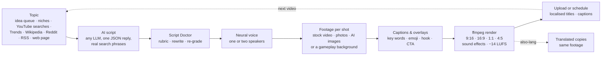

<div align="center">

<picture>
  <source media="(prefers-color-scheme: dark)" srcset="https://raw.githubusercontent.com/Chamanrajragu/purffle-shorts/main/docs/logo-dark.svg">
  
</picture>

# PurffleShorts — Free AI YouTube Shorts Generator, Faceless Video Maker & Opus Clip Alternative

**English** · [简体中文](https://github.com/Chamanrajragu/purffle-shorts/blob/main/README.zh-CN.md) · [Español](https://github.com/Chamanrajragu/purffle-shorts/blob/main/README.es.md) · [Português](https://github.com/Chamanrajragu/purffle-shorts/blob/main/README.pt-BR.md) · [हिन्दी](https://github.com/Chamanrajragu/purffle-shorts/blob/main/README.hi.md) · [日本語](https://github.com/Chamanrajragu/purffle-shorts/blob/main/README.ja.md)

**An open-source AI video generator for YouTube Shorts, TikTok and Instagram Reels. Give it a topic, a web page, a Reddit post or a long podcast, and it makes finished vertical videos (script, voiceover, footage, captions, sound effects), then uploads or schedules them on YouTube, TikTok and Instagram.**<br>
YouTube automation in Python that runs on your own computer. The AI model you choose writes the script (GPT, Claude, Gemini, Llama through Ollama, DeepSeek, Grok, Mistral or any OpenAI-compatible API), using the phrases people actually search for on YouTube, and a second AI pass grades and rewrites it. Free neural voices read it, and stock footage, AI images or your own gameplay video fill the screen. Captions appear word by word, with key words in colour and an emoji per scene. It makes **Reddit story videos**, **fake text message videos** and **two-voice dialogues**, and **clips podcasts into Shorts** with jump cuts and face tracking. Free, MIT-licensed, no watermark. It also works from Claude Desktop, Claude Code and Cursor through MCP.

[](https://github.com/Chamanrajragu/purffle-shorts/actions/workflows/ci.yml)
[](https://python.org)
[](https://github.com/Chamanrajragu/purffle-shorts/blob/main/LICENSE)
[](https://colab.research.google.com/github/Chamanrajragu/purffle-shorts/blob/main/notebooks/PurffleShorts.ipynb)
[](https://github.com/Chamanrajragu/purffle-shorts/stargazers)
<br>
[](#-ai-models)
[](#%EF%B8%8F-voices)
[](#-formats)
[](#%EF%B8%8F-clip-podcasts-into-shorts-free-opus-clip-alternative)
[](#-publishing--scheduling)
[](#-use-it-from-claude-and-other-ai-apps-mcp)

[Features](#-features) · [Quick start](#-quick-start) · [Colab](#%EF%B8%8F-run-it-in-google-colab) · [Formats](#-formats) · [Reddit & gameplay](#-reddit-story-videos-over-gameplay-split-screen) · [Clip podcasts](#%EF%B8%8F-clip-podcasts-into-shorts-free-opus-clip-alternative) · [SEO](#-seo-built-in-real-youtube-searches-localised-titles-captions) · [AI models](#-ai-models) · [Voices](#%EF%B8%8F-voices) · [Publishing](#-publishing--scheduling) · [Studio](#%EF%B8%8F-studio-web-app) · [API](#-rest-api-and-automation-n8n-zapier-cron) · [MCP](#-use-it-from-claude-and-other-ai-apps-mcp) · [Compare](#%EF%B8%8F-how-it-compares) · [FAQ](#-faq)


<sub>Real output, no editing: <code>examples/flamingos.json</code>, <code>examples/dialogue.json</code> and <code>examples/chat-story.json</code> rendered with <code>make --script</code>.<br>
Free Microsoft neural voices, AI images from Pollinations (for the octopus videos they were downloaded one by one into a local folder first, because keyless Pollinations now allows about one image every few minutes). GIFs have no sound.</sub>

**Try it with no API keys and no sign-up** (needs [uv](https://docs.astral.sh/uv/)):

```bash
uvx --from git+https://github.com/Chamanrajragu/purffle-shorts purffle-shorts demo --style chat
```

…or **[open it in Google Colab](https://colab.research.google.com/github/Chamanrajragu/purffle-shorts/blob/main/notebooks/PurffleShorts.ipynb)** and make videos in your browser, with nothing to install.

**⭐ If PurffleShorts saves you time, a star helps other creators find it.** &nbsp;·&nbsp; 🌐 [purffle.com/purffle-shorts](https://purffle.com/purffle-shorts/)

<!-- mcp-name: io.github.Chamanrajragu/purffle-shorts -->

</div>

---

## 🤖 What is PurffleShorts?

PurffleShorts is a **YouTube Shorts automation tool** for faceless channels. Start it and it keeps going: fresh topic, retention-focused script that a second AI pass reviews and tightens, natural AI voiceover, relevant footage, captions synced to each spoken word, sound effects, a polished render, and an upload or scheduled release. It stays inside YouTube's daily API quota.

Beyond the autopilot, it is a small studio:
- Draft a script and edit any line before rendering.
- Make **two-voice dialogues**, **text-message stories** and **Reddit-style stories**, over stock footage or your own **gameplay background**.
- Turn an article or a Reddit post into a Short.
- **Clip a podcast into Shorts**, an Opus Clip-style workflow that runs on your computer, with jump cuts, punch-in zoom and face tracking.
- Publish the same video in **several languages**, and plan a week of ideas from **what people search for on YouTube**.
- Let the channel's own view counts steer new scripts.

It is made for **content creators**, **faceless YouTube channels**, **educators** and **marketers** who want short-form video at volume without editing by hand. It runs on your own computer (macOS, Windows, Linux), in **Docker** or in **Google Colab**. You pick every model, and the same video can go to **TikTok** and **Instagram Reels** as well as YouTube.

---

## 🎯 Use cases

- **A faceless channel on autopilot.** Pick a niche (space, history, animals, money tips), set three publish times a day and leave it running. Ideas come from real YouTube searches, Trends, Wikipedia, Reddit, RSS or your list, and are never reused. The AI is told to avoid your recent titles, and every script is reviewed before it is voiced.
- **Reddit story videos over gameplay.** The AI writes a first-person post, a narrator reads it over a post card, and your Minecraft parkour or other gameplay clip plays underneath: full screen, or split screen with footage on top. A real Reddit post link works as the source too.
- **Fake text message videos** for Shorts, TikTok and Reels: the AI writes a fictional chat, two voices read it, and the phone screen is animated with a pop as each message lands.
- **Podcast, interview and stream clips.** `clip episode.mp4 --count 5` transcribes the video and lets the AI pick the moments that stand on their own (or the ones matching your brief, such as "the funniest bits"). You get captioned vertical clips with pauses and ums removed, the speaker kept in frame and a virality score each. There are no per-minute fees.
- **Articles, blog posts and notes into video.** `make --url https://…` or `--from-file notes.md` turns your own writing into a Short.
- **One idea, many languages.** `--also-lang es,hi,pt` publishes the same video with native voices in each language. `LOCALIZE_METADATA` translates the title and description of every upload.
- **Education and explainers.** Quiz, myth-vs-fact, explainer and dialogue formats, in 9:16 for Shorts or 16:9 for regular YouTube.
- **Automations and AI assistants.** Drive it from n8n, Zapier or cron through the [REST API](https://github.com/Chamanrajragu/purffle-shorts/blob/main/docs/api.md), or ask Claude or Cursor to make, clip or upload videos through MCP.

---

## ✨ Features

**AI scriptwriting**
- One structured LLM call returns the whole Short: hook, scenes, a footage search, an image prompt, key words and an emoji per scene, title, description, hashtags, tags and YouTube category.
- **Script Doctor**: a second AI pass grades the draft on six points (hook, curiosity, pacing, specificity, payoff, accuracy), lists what is weak and rewrites it. The rewrite is graded again and only kept if it scores at least as well, so the 0–100 retention score always belongs to the script you actually get. Automatic checks (hook length, filler words, missing call to action, no concrete numbers) feed the review.
- **Written for search**: the phrases YouTube's own search box suggests for the topic are handed to the writer, so titles, descriptions and tags use the words people actually type.
- Strict JSON-schema replies on providers that support them (OpenAI, Gemini, OpenRouter, Ollama, LM Studio, Claude), with an automatic step down for the ones that don't.
- **12 providers**: OpenAI, Anthropic Claude, Google Gemini, Groq, OpenRouter, DeepSeek, Mistral, Together AI, xAI Grok, Ollama, LM Studio, or any OpenAI-compatible URL. List backups in `LLM_FALLBACKS` and they are tried in order if the main one fails.
- **11 formats**: facts, story, listicle, myth-busting, quiz, explainer, motivational, news, **two-voice dialogue**, **text-message story** and **Reddit-style story** (a post card while the title is read, then the story with captions).
- Draft first and edit any line in the Studio, or write a script yourself and render it with `--script`, with no LLM call.

**Sources**
- Your niches, **questions people search for on YouTube** (`TOPIC_SOURCES=search`), Google Trends, Wikipedia "On this day", Reddit TIL, **RSS feeds**, your own list, **any web page or Reddit post** (`--url`) or **document** (`--from-file`).
- **Content planner**: the AI brainstorms a batch of specific, true, non-repeating ideas, guided by real YouTube searches, into a queue that the autopilot uses first.

**Voiceover**
- 320+ free Microsoft neural voices in 75 languages, with word-level timestamps. No key needed.
- Two speakers for dialogues and chat stories, each with their own voice, joined with natural pauses.
- **One video, many languages**: `--also-lang es,hi` adds translated copies that reuse the same footage.
- Also OpenAI TTS, ElevenLabs, Kokoro-82M, Coqui and the operating-system voice. Falls back to the free voice if a paid engine fails.

**Footage & backgrounds**
- A separate stock-footage search for every scene (Pexels, Pixabay). Each candidate is scored by how well its own description matches the scene, the search engine's ranking, shape and length; portrait clips preferred, never reused across videos.
- **Gameplay and background videos** (`BACKGROUND_VIDEO`): one continuous stretch of your Minecraft parkour, Subway Surfers or "satisfying" clip plays under the whole story, either full screen or **split screen** with the scene footage on top.
- **Fast pacing**: scenes longer than 4.5 s are cut into several shots with different footage, each cut placed on a natural pause between words.
- AI images per scene from OpenAI (gpt-image-1 / DALL·E 3) or Pollinations, or your own `media/` folder. Ken Burns motion on photos, colour grades, transitions.

**Captions, sound & editing**
- Captions appear exactly when each word is spoken, with the current word highlighted. **Key words and numbers get their own colour**, and **an emoji per scene** pops up above them. 6 styles; Latin, Indic, Arabic, Thai and CJK scripts.
- **Sound effects** made in code (nothing to license): a whoosh on each scene change, a pop as each text message lands, a low hit under the hook. They are mixed 11 dB under the measured voice.
- Dialogues get speaker name tags and a colour per speaker; chat stories get an animated phone screen with typing indicators; Reddit-style stories open on a post card (community, poster, title, votes).
- **9:16, 16:9, 1:1 or 4:5** output (`--aspect`), with captions and overlays sized for each shape.
- Hook title, watermark, progress bar, end call-to-action, background music that ducks under the voice.
- **Broadcast-grade audio**: gentle voice clean-up (rumble cut, de-esser, compression), then two-pass loudness normalisation that measures the mix and applies one steady gain, landing on −14 LUFS without pumping.
- Voices without word timestamps get their phrase ends pinned to the real pauses in the audio, so captions stay in sync even without an aligner.
- The cover image is the sharpest, best-exposed frame of the opening seconds, never a frame mid-transition.
- Plain ffmpeg: each shot is prepared as a short segment, the soundtrack is mixed and normalised in its own pass, then one final encode joins them and adds everything above. No MoviePy, no ImageMagick, no GPU needed.

**Clipping (a free Opus Clip alternative)**
- Transcribes podcasts, interviews and streams locally with Whisper. The AI picks self-contained moments with a hook and a payoff, or only the ones that fit your brief (`--prompt "every tip about sleep"`).
- Each clip has a **virality score** with the reason. It is edited with **jump cuts** (long pauses shortened, "um" and "uh" removed, lips kept in sync) and **punch-in zoom** between sentences.
- Framing: **face tracking** (`--crop face`), the centre, or the whole picture over a blurred copy. Word-by-word captions are added too.

**Publishing & SEO**
- Uploads to YouTube, or schedules each video into your next free time slot.
- **TikTok, Instagram Reels and more** (`PUBLISH_TO=youtube,tiktok,instagram`): the same video goes out with a caption written for each network, at the same publish slot, through Upload-Post or Instagram's own API. Each network's result is saved, and a retry only re-sends what failed.
- **Localised titles and descriptions** (`LOCALIZE_METADATA=es,pt,hi`), so viewers see the video under a title in their own language, and optional **caption-track upload** (`UPLOAD_CAPTIONS`) so YouTube can index every word.
- Quota-aware queue, AI-content disclosure, playlists, privacy, made-for-kids flag.
- Every video also gets a cover image, SRT subtitles and a metadata file for cross-posting.

**Workflow**
- Autopilot loop, one-off videos, bulk batches with parallel workers, several channels from separate settings files.
- **Studio web app**: create, draft and edit, and watch every stage live (pushed instantly, with a percentage and a time-left estimate learned from your machine). Cancel a running job, browse and play the library, plan ideas, clip videos and read channel stats. `STUDIO_PASSWORD` protects it when it runs on a server.
- **REST API** for n8n, Zapier, cron or your own scripts ([docs/api.md](https://github.com/Chamanrajragu/purffle-shorts/blob/main/docs/api.md)), a **Google Colab notebook**, and **docker compose** for servers.
- A live progress line in the terminal, and a voice cache so re-rendering an edited script only voices the lines that changed.
- **MCP server**: ask Claude Desktop, Claude Code or Cursor to make, clip or upload videos.
- **Learns from your channel** (opt-in): view counts of your uploads show the AI what works for your audience, and the format of each new video is chosen by Thompson sampling over your own results. `stats` tells you whether the retention score actually predicts your views (Spearman correlation) and which publish hours did best.
- Discord / Slack / webhook notifications, a `doctor` self-check, SQLite history, and CI that renders real videos on every pull request.

---

## 🆕 New since 3.0

| | What you get |
|---|---|
| **Retention editing** | Key words and numbers highlighted in captions, an emoji per scene, and sound effects (whoosh, pop, hit) placed 11 dB under the voice |
| **Gameplay backgrounds** | `--background parkour.mp4`: one video under the whole story, full screen or `--layout split` |
| **Smarter clipping** | Jump cuts (pauses and ums removed, lips in sync), punch-in zoom, face tracking, `--prompt` to steer the picks, and a virality score with the reason |
| **Search-led SEO** | Topics and keywords from real YouTube searches, titles and descriptions localised for other languages, optional caption-track upload |
| **Better scripts** | Script Doctor 2.0: a six-part rubric, automatic checks, and a rewrite kept only if it scores at least as well |
| **Faster, live renders** | About 40% faster on the same machine, a Studio that pushes progress with a time-left estimate, and cancel at any time |
| **A new Studio** | Its own design in light and dark: a numbered brief, a program monitor, an edit timeline for every job, the library as a contact sheet, and a new logo |
| **TikTok and Instagram** | `PUBLISH_TO=youtube,tiktok,instagram`: one video to every network, scheduled together, each result tracked and retried on its own |
| **Run it anywhere** | Google Colab notebook, docker compose with the published image, REST API with an n8n recipe |

The [changelog](https://github.com/Chamanrajragu/purffle-shorts/blob/main/CHANGELOG.md) has the full list, with the measured before-and-after numbers.

---

## ⚖️ How it compares

Open-source Shorts tools each cover part of the job: some write videos from a topic, some clip long videos, some make Reddit stories. PurffleShorts does all three. It is the only one we found with text-message stories, two-voice dialogues, a script review pass, and an MCP server that covers writing, clipping and uploading.

| | **PurffleShorts** | [MoneyPrinterTurbo](https://github.com/harry0703/MoneyPrinterTurbo) | [ShortGPT](https://github.com/RayVentura/ShortGPT) | [RedditVideoMakerBot](https://github.com/elebumm/RedditVideoMakerBot) | [AI-Youtube-Shorts-Generator](https://github.com/Anil-matcha/AI-Youtube-Shorts-Generator) | [OpenShorts](https://github.com/mutonby/openshorts) |
|---|:-:|:-:|:-:|:-:|:-:|:-:|
| Writes the video from a topic | ✅ | ✅ | ✅ | ❌ Reddit threads | ❌ clipper | ➖ paid APIs |
| Any LLM, including local Ollama | ✅ | ✅ | ➖ OpenAI, Gemini | ❌ no LLM | ➖ OpenAI, Gemini | ✅ |
| Free voices, no key | ✅ | ✅ | ✅ | ✅ | ❌ no voice | ➖ ElevenLabs |
| Word-by-word highlighted captions | ✅ key words + emoji | ➖ | ❔ | ❌ | ❌ | ✅ |
| Script review and rewrite pass | ✅ | ❌ | ❌ | ❌ | ❌ | ❌ |
| Text-message chat stories | ✅ | ❌ | ❌ | ❌ | ❌ | ❌ |
| Two-voice dialogues | ✅ | ❔ | ❔ | ❌ | ❌ | ❌ |
| Reddit-style stories | ✅ | ❌ | ✅ | ✅ | ❌ | ❌ |
| Gameplay background, split screen | ✅ | ❔ | ❔ | ✅ background library | ❌ | ❔ |
| Clip long videos into Shorts | ✅ face tracking | ❌ | ❌ | ❌ | ✅ | ✅ |
| Silence and filler removal in clips | ✅ | ❌ no clipping | ❌ no clipping | ❌ no clipping | ❔ | ❔ |
| Videos in other languages | ✅ | ✅ | ✅ | ✅ | ➖ | ✅ paid dubbing |
| YouTube upload and scheduling | ✅ official API | ➖ via Upload-Post, no scheduling | ❌ | ❌ by design | ❌ | ✅ via Upload-Post |
| TikTok / Instagram upload | ✅ via Upload-Post, or Instagram's API | ✅ via Upload-Post | ❌ | ❌ | ❌ | ✅ via Upload-Post |
| MCP server | ✅ | ❌ | ❌ | ❌ | ❌ | ✅ clipping |
| Web app | ✅ | ✅ | ✅ | ➖ settings only | ❌ | ✅ |
| Colab notebook | ✅ | ✅ | ✅ | ❔ | ❔ | ❔ |
| Tests and CI | ✅ | ✅ | ❌ | ➖ lint only | ❌ | ✅ |
| License | MIT | MIT | MIT | GPL-3.0 | MIT | MIT |

<sub>✅ yes · ➖ partly · ❌ no · ❔ not stated. Compiled on 29 September 2026 from each project's README and code; the gameplay, silence-removal and Colab rows were checked on 20 October 2026. Projects change quickly: if a cell is wrong, please <a href="https://github.com/Chamanrajragu/purffle-shorts/issues">open an issue</a> and it will be fixed. Where others are ahead: RedditVideoMakerBot ships a library of background videos, and MoneyPrinterTurbo has a one-click Windows package.</sub>

---

## 📸 Screenshots

**New in 3.0: text-message stories, two-voice dialogues and Reddit-style stories.** Rendered from [`examples/chat-story.json`](https://github.com/Chamanrajragu/purffle-shorts/blob/main/examples/chat-story.json), [`examples/dialogue.json`](https://github.com/Chamanrajragu/purffle-shorts/blob/main/examples/dialogue.json) and [`examples/reddit-story.json`](https://github.com/Chamanrajragu/purffle-shorts/blob/main/examples/reddit-story.json).

<p align="center"></p>

**Frames from the flamingo Short above**: hook title, word-highlighted captions, progress bar, end call-to-action.

<p align="center"></p>

**Six caption styles**, drawn by the same renderer the videos use:

<p align="center"></p>

**Studio**, the local web app, in light and dark. The Create page is a numbered brief (subject, format, shape and voice, look and sound, model and publishing) beside a program monitor that previews the caption style, shape and safe area.

<p align="center"></p>

The library is a contact sheet of everything you made. Open a video to play it, publish it to YouTube, TikTok and Instagram, edit and re-render it, or delete it.

<p align="center"></p>

<table><tr>
<td width="50%"></td>
<td width="50%"></td>
</tr><tr>
<td><sub>A video's page: player, publishing, the details and the description.</sub></td>
<td><sub>The queue: each job's stage timeline, time left and live log.</sub></td>
</tr></table>

**Command line**: `doctor` checks the setup, `make` renders a Short.

<p align="center"></p>

---

## 🗂️ Earlier releases

<details>
<summary><b>What changed in 3.0</b> (new formats, clipping, the Studio, MCP)</summary>

| | 2.0 | 3.0 |
|---|---|---|
| Script quality | One LLM call | **Script Doctor**: a second pass scores retention 0–100, lists the problems and rewrites weak lines. You can also draft first and edit every line in the Studio |
| Formats | 8, one narrator | **11**, including **two-voice dialogues** (name tags, colour per speaker), **text-message stories** (animated phone screen, typing indicator) and **Reddit-style stories** (post card, then captions) |
| Sources | Niches, Trends, Wikipedia, Reddit, your list | Also **any web page or Reddit post** (`--url`), **documents** (`--from-file`), **RSS feeds**, and an **AI content planner** with an idea queue |
| Long videos | — | **`clip`**: transcribe a podcast or talk, the AI picks self-contained moments, vertical crop or blurred fit, word captions |
| Languages | One per video | **`--also-lang es,hi`**: translated copies of the same video that reuse its footage |
| Shapes | 9:16 | **9:16, 16:9, 1:1, 4:5** with sizes that adapt (`--aspect`) |
| Channel feedback | — | **Learns from stats** (opt-in): the best and worst performers are shown to the AI when it writes |
| Web app | A form and a list | **New Studio**: live stage progress, script editor, library with player and actions, ideas, clipping, channel stats, setup checks. Works on phones |
| Integrations | — | **MCP server** for Claude Desktop, Claude Code and Cursor; Discord / Slack / webhook notifications |
| Reliability | | Clear errors for bad settings, hardware-encoder fallback to libx264, failed videos return their idea to the queue, database migrates itself, installs cleanly on Intel Macs, 120+ tests, Docker build checked in CI |

</details>

<details>
<summary><b>What changed in 2.0</b> (the rewrite from 1.x)</summary>

Version 2 is a rewrite. The 1.x pipeline had problems: the pinned `openai` SDK no longer had the API the code called, landscape footage was stretched into portrait, captions were evenly spaced rather than following the voice, the title and description were generated separately from the script, and every video went through six MoviePy re-encodes.

| | 1.x | 2.0 |
|---|---|---|
| Script | GPT-3.5, 4 separate calls, title unrelated to script | **One structured call**: hook, scenes, per-scene footage queries, title, description, hashtags, tags, category |
| Models | OpenAI only | **OpenAI, Claude, Gemini, Groq, OpenRouter, DeepSeek, Mistral, Together, xAI, Ollama, LM Studio, any OpenAI-compatible URL**, with optional fallbacks |
| Voice | Coqui Tacotron2 (robotic, heavy) | **Free Microsoft neural voices** (320+, 75 languages) + OpenAI, ElevenLabs, Kokoro, Coqui, system voice |
| Captions | Even time slices, no sync | **Word-accurate timing**, active-word highlight, pop-in animation, 6 styles |
| Footage | Same query for every clip, landscape stretched to 9:16 | **A search per scene**, portrait-first, smart 9:16 crop, never reused across videos, Ken Burns on photos, AI images optional |
| Render | MoviePy + ImageMagick, 6 encodes at 60 fps | **ffmpeg only**, one final encode, transitions, colour grades, progress bar. A 25 s Short rendered in 30–40 s on an Intel Mac in testing |
| Audio | Music at a fixed volume | **Music auto-ducks under the voice**, loudness normalised to −14 LUFS |
| Publishing | Always public, burns quota | **Schedule into time slots**, privacy options, AI-content disclosure, playlists, quota-aware queue |
| Ideas | 22 hard-coded categories, repeats | **Niches, Google Trends, Wikipedia "On this day", Reddit TIL, your own list**, with repeats prevented |
| Extras | — | Web dashboard, `doctor` self-check, history DB, SRT subtitles, cover image, `--script` for your own scripts, Docker, CI with an offline end-to-end render test |

</details>

---

## 🔄 How it works



| Step | What happens |
|------|-------------|
| 1. **Topic** | Queued ideas come first. Then one of your sources: your niches, questions people type into YouTube's search box, today's Google Trends, Wikipedia "On this day", Reddit TIL (best effort, since Reddit rate-limits anonymous requests) or `topics.txt`. Anything already made is skipped, and so is news about deaths, violence or elections |
| 2. **Script** | The LLM writes a hook-first script split into scenes. Each scene has its own stock-footage query, AI-image prompt, key words and emoji. The same JSON reply holds the title, description, hashtags, tags and category. Real YouTube search phrases for the topic are part of the prompt; with `LEARN_FROM_STATS`, so are your best and worst performers |
| 3. **Review** | The Script Doctor grades it on a six-part rubric, rewrites weak lines and grades the rewrite again, keeping whichever scores higher (`SCRIPT_REVIEW=rewrite`, the default). A rewrite that misses the target length is ignored, and a failed review never fails the video |
| 4. **Voice** | Neural TTS speaks the script and returns per-word timestamps (or they are aligned with Whisper, or pinned to the pauses in the audio). Dialogues and chats are voiced line by line with two voices; lines spoken before come from the voice cache |
| 5. **Footage** | Each shot gets its own clip, chosen for how well its description matches the scene. Sources: Pexels / Pixabay video (portrait preferred), photos with Ken Burns motion, your own `media/` folder or AI images, with an animated gradient as the last resort. Long scenes are cut into several shots. With `BACKGROUND_VIDEO`, one stretch of your gameplay video plays under everything, full screen or split |
| 6. **Captions** | 2–3-word captions appear exactly when spoken, with the current word highlighted, key words and numbers in their own colour, and the scene's emoji above. Chat stories show messages popping in on a phone screen instead, and Reddit-style stories open on a post card |
| 7. **Render** | Shots are cover-cropped to the output shape, colour-graded and joined (hard cuts inside a scene, transitions between scenes). One final ffmpeg encode adds the hook title, watermark, progress bar and end CTA. The soundtrack (voice, ducked music, sound effects) is normalised to −14 LUFS in two passes, and the cover is the best frame of the hook |
| 8. **Publish** | Uploaded now, or scheduled into your next free time slot, with the synthetic-media disclosure set, localised titles and, if you like, the caption track. Uploads are queued automatically when the daily quota is used up |

---

## 🚀 Quick start

**Needs:** Python 3.10+. ffmpeg is used if installed; if not, the bundled `imageio-ffmpeg` binary is used. ImageMagick is no longer needed.

**Fastest:** with [uv](https://docs.astral.sh/uv/) installed, run it straight from GitHub without cloning anything:

```bash
uvx --from git+https://github.com/Chamanrajragu/purffle-shorts purffle-shorts demo
```

**To keep it and configure it**, clone and install:

```bash
git clone https://github.com/Chamanrajragu/purffle-shorts.git
cd purffle-shorts
python -m venv venv && source venv/bin/activate      # Windows: venv\Scripts\activate
pip install -e .                                     # or: pip install -r requirements.txt
```

**1. See it work with no keys at all.** This renders a sample Short with a built-in script, a free neural voice and generated backgrounds:

```bash
python -m purffle_shorts demo
python -m purffle_shorts demo --style chat        # text-message story
python -m purffle_shorts demo --style dialogue    # two voices
python -m purffle_shorts demo --style reddit      # Reddit-style story with a post card
```

Or open the web app and click through it (demo mode is on until you add a key):

```bash
python -m purffle_shorts studio
```

**2. Configure.** Copy `.env.example` to `.env`, add **one** LLM key (or run Ollama) and a Pexels and/or Pixabay key (both free), then run the self-check:

```bash
python -m purffle_shorts doctor
```

**3. Make one video** (kept locally, not uploaded):

```bash
python -m purffle_shorts make --topic "why octopuses have three hearts" --no-upload
```

**4. Connect YouTube once.** Create an OAuth client of type *Desktop app* in Google Cloud Console with the YouTube Data API v3 enabled, save it as `credentials.json`, then:

```bash
python -m purffle_shorts auth
```

**5. Autopilot:**

```bash
python -m purffle_shorts plan --count 14   # optional: queue two weeks of ideas first
python -m purffle_shorts run               # or the old way:  python YT.py
```

**Optional extras:** `pip install -e ".[clip]"` adds faster-whisper and yt-dlp for [clipping podcasts and long videos](#%EF%B8%8F-clip-podcasts-into-shorts-free-opus-clip-alternative), and `pip install -e ".[face]"` adds face tracking.

---

## ☁️ Run it in Google Colab

[](https://colab.research.google.com/github/Chamanrajragu/purffle-shorts/blob/main/notebooks/PurffleShorts.ipynb)

The [notebook](https://github.com/Chamanrajragu/purffle-shorts/blob/main/notebooks/PurffleShorts.ipynb) installs PurffleShorts in Google's free cloud machines and walks through it in six cells:
1. install;
2. a demo with no keys;
3. your keys from Colab Secrets (a free Gemini key is enough to write scripts);
4. a Short about any topic;
5. clipping an uploaded podcast, faster on a free T4 GPU;
6. downloading everything as a zip.

Nothing is uploaded to YouTube from the notebook.

---

## 💬 Formats

Pick one with `SCRIPT_STYLE` / `--style`, or leave it on `auto`.

| Format | What you get |
|---|---|
| `facts` · `story` · `listicle` · `myth` · `quiz` · `explainer` · `motivational` · `news` | One narrator, footage per scene, word-highlighted captions |
| `dialogue` | Two people talking: A asks or doubts, B answers with specifics. Each line is voiced with its own voice (`TTS_VOICE` and `TTS_VOICE_B`, or automatic), captions carry the speaker's name and colour |
| `chat` | A text-message story: messages pop into a phone screen as they are read aloud, the contact's replies get a typing indicator, the chat scrolls when it fills up. Each side has its own voice |
| `reddit` | A first-person story told like a Reddit post: a post card (community, poster, title, votes) is shown while the title is read, then the story plays with word captions. Written by the AI as fiction, or adapted from a post you link with `--url` |

```bash
purffle-shorts make --style chat --topic "a babysitter gets texts from an unknown number"
purffle-shorts make --style dialogue --topic "why the sky is blue"
purffle-shorts make --style reddit --topic "a neighbour who keeps borrowing my ladder"
purffle-shorts make --url "https://www.reddit.com/r/tifu/comments/…"   # a real post as the source
```

Scripts from the LLM are fiction for `chat` and `reddit` (the prompt forbids real people). Reddit post links are read through the post's public feed; only reuse posts when you have the author's permission. As with every format, read before you publish.

---

## 🎮 Reddit story videos over gameplay (split screen)

The classic Reddit-story look is a narrator over Minecraft parkour, Subway Surfers or a "satisfying" clip. Give PurffleShorts a background video (or a folder of them, one picked at random per Short) and one continuous, randomly chosen stretch of it plays under the whole story:

```bash
purffle-shorts make --style reddit --background media/backgrounds/parkour.mp4                 # full screen
purffle-shorts make --style reddit --background media/backgrounds/ --layout split             # footage on top, gameplay below
purffle-shorts make --style chat   --background media/backgrounds/                            # a text story over gameplay
purffle-shorts demo --style reddit --background my-gameplay.mp4                               # try it with no keys
```

Or set `BACKGROUND_VIDEO=media/backgrounds` and `BACKGROUND_LAYOUT=full|split` in `.env`, or pick a video in the Studio's *Look* card (it lists everything in `media/backgrounds/`). In the split layout the scene footage is searched in the top half's shape and the captions sit on the seam, the usual "brainrot" layout that keeps eyes on screen. Sound effects, key-word captions and the post card work as usual. Use only gameplay you recorded yourself or have the rights to reuse.

---

## ✂️ Clip podcasts into Shorts (free Opus Clip alternative)

```bash
pip install faster-whisper                          # free, local transcription (or set OPENAI_API_KEY)
purffle-shorts clip podcast.mp4 --count 3           # fill the frame
purffle-shorts clip interview.mp4 --crop face       # follow the speaker (pip install opencv-python-headless)
purffle-shorts clip talk.mp4 --count 5 --crop blur  # whole picture over a blurred copy
purffle-shorts clip episode.mp4 --prompt "the funniest moments"   # only the moments that fit a brief
purffle-shorts clip "https://…" --count 3           # URLs need: pip install yt-dlp
```

It works like Opus Clip, Klap or Vidyo.ai, but locally, with no per-minute fees and no watermark beyond your channel name. The video is transcribed with word timings. The LLM reads the timestamped transcript and picks moments of 20–58 s (`--min-seconds`, `--max-seconds`) that open with a hook and end on a complete thought, or only those matching your `--prompt`. Each moment gets a title, hashtags and a **virality score with the reason**. Each clip is cut on sentence boundaries, cropped to 9:16, captioned word by word with a hook title, and loudness-normalised.

**Edited like a pro editor would:** **jump cuts** shorten pauses longer than `CLIP_MAX_PAUSE` (0.6 s) and remove "um" and "uh". Cuts land on frame boundaries and the sound is cut at exactly the same instants, so lips stay in sync however many cuts there are. **Punch-in zoom** changes the framing between sentences, at most every 2 seconds. Turn them off with `--no-jump-cuts` and `--no-zoom` (or `CLIP_JUMP_CUTS=false`, `CLIP_ZOOM=false`).

Without an LLM it still works, with moments spread evenly over the video instead. Transcription uses `WHISPER_MODEL` (`auto` picks `large-v3-turbo` on an NVIDIA GPU and `small` on a CPU) with voice-activity detection, so music and silence don't turn into invented words. `--crop face` finds the speaker's face twice a second (OpenCV's YuNet detector, a 230 KB model downloaded once) and keeps it in frame, switching framing only when the camera cuts. Clips upload like any other video when `UPLOAD=true`; add `--no-upload` to only cut them. Only clip videos you own or have permission to reuse.

---

## 🗓️ Ideas, sources and languages

- **What people search for:** `TOPIC_SOURCES=niche:2,search:2` mixes in questions people type into YouTube's search box about your niches ("why do octopuses have three hearts", "what happens when two oceans meet"); the AI answers the one that fits best.
- **Plan ahead:** `purffle-shorts plan --count 14 --niche "space"` asks the AI for specific, true, non-repeating ideas with a format and an angle each, guided by real YouTube searches. `ideas` lists the queue (`--add`, `--remove`, `--clear`). Queued ideas are always made first; if a video fails, its idea goes back in the queue.
- **From a web page, a Reddit post or a document:** `make --url https://…` or `make --from-file notes.md` uses the text as the script's source material. A Reddit post link picks the Reddit story format automatically.
- **RSS:** `RSS_FEEDS=https://…/feed.xml,https://…` and `TOPIC_SOURCES=niche:3,rss:1`.
- **Many languages:** `ALSO_LANGUAGES=es,hi` (or `--also-lang`) makes a translated copy of every video with a native voice, reusing the original's footage. Each copy is its own upload, linked to the original in the library.

---

## 🔍 SEO built in: real YouTube searches, localised titles, captions

A Short that nobody searches for only lives as long as the Shorts feed shows it. PurffleShorts writes with search in mind:

- **Real search phrases** (`SEO_KEYWORDS=true`, the default): before writing, it asks YouTube's own search box what people type about the topic ("why do octopuses have three hearts", "octopus blue blood"). It hands those phrases to the script writer, which uses the matching ones word for word in the title, the first line of the description and the tags. Off-topic suggestions (documentaries, games, "in hindi" and so on), sensitive and adult ones are filtered out. They are saved in `metadata.json` as `search_keywords`.
- **Topics people are looking for** (`TOPIC_SOURCES=search`) and a planner that prefers ideas answering real searches.
- **Localised titles and descriptions** (`LOCALIZE_METADATA=es,pt,hi,fr`): one extra LLM call translates the title and description, and the upload carries them as YouTube localizations. Viewers whose YouTube is in Spanish see the Spanish title, and so on, while the video stays one upload.
- **Caption tracks** (`UPLOAD_CAPTIONS=true`): the exact subtitles are uploaded with the video, so YouTube has every spoken word to index (400 API units per video; run `auth` once more after turning it on).
- Titles under 100 characters with `#shorts`, descriptions with a question that invites comments, 3–5 hashtags, tags kept under YouTube's 500-character limit, the right category, language and audio language, and the synthetic-media disclosure.

---

## 📊 Learn from your channel

```bash
LEARN_FROM_STATS=true
YOUTUBE_API_KEY=...        # optional: reads public stats without asking for more OAuth access
```

`purffle-shorts stats` (and the Studio's Channel page) reads view, like and comment counts of the videos PurffleShorts uploaded: one API unit per 50 videos. With `LEARN_FROM_STATS=true` the autopilot refreshes them twice a day and shows the LLM your best and worst performers (public for 48 hours or more) when it writes and plans. Without `YOUTUBE_API_KEY`, run `auth` once more to grant read access.

Once 8 or more videos have stats, `SCRIPT_STYLE=auto` stops picking formats at random: each format's typical view count gets a statistical estimate that tightens as its videos come in, and the next format is drawn by Thompson sampling. Formats that work for your audience are chosen more often, and untried ones still get a fair chance. `stats` also checks the predictions against reality: the Spearman correlation between the Script Doctor's retention score and real views, median views per format, and the publish hours that did best.

---

## 🧠 AI models

Set `LLM_PROVIDER` and `LLM_MODEL` in `.env`, or pass `--provider` / `--model`. With `LLM_PROVIDER=auto` the first key found is used, and a running Ollama is used when there is no key. `LLM_FALLBACKS=anthropic,gemini` retries with other providers when the main one fails. Any model a provider offers works; the defaults are only starting points.

| Provider | `LLM_PROVIDER` | Key | Default model |
|---|---|---|---|
| OpenAI | `openai` | `OPENAI_API_KEY` | `gpt-4o-mini` (GPT-5 / o-series supported) |
| Anthropic Claude | `anthropic` | `ANTHROPIC_API_KEY` | `claude-opus-5-5` (structured JSON output) |
| Google Gemini | `gemini` | `GEMINI_API_KEY` | `gemini-2.5-flash` |
| Groq | `groq` | `GROQ_API_KEY` | `llama-3.3-70b-versatile` |
| OpenRouter | `openrouter` | `OPENROUTER_API_KEY` | `openai/gpt-4o-mini`, or any of its hundreds of models |
| DeepSeek | `deepseek` | `DEEPSEEK_API_KEY` | `deepseek-chat` |
| Mistral | `mistral` | `MISTRAL_API_KEY` | `mistral-small-latest` |
| Together AI | `together` | `TOGETHER_API_KEY` | `meta-llama/Llama-3.3-70B-Instruct-Turbo` |
| xAI | `xai` | `XAI_API_KEY` | `grok-3-mini` |
| Ollama (local, free) | `ollama` | — | `llama3.1`, or the first model you have pulled |
| LM Studio (local, free) | `lmstudio` | — | whatever is loaded |
| Anything OpenAI-compatible | `custom` | `LLM_API_KEY` + `LLM_BASE_URL` | `LLM_MODEL` |

`python -m purffle_shorts providers` shows which providers have a key and whether Ollama / LM Studio are running.

**Script Doctor** (`SCRIPT_REVIEW`): `rewrite` (default) scores every script and uses the improved version, `score` only records the score and the problems, `off` skips it (`--no-review`). Rewrite mode adds two LLM calls per video (the review with its rewrite, then the re-grade), score mode one.

> **Facts need a capable model.** In testing, a 3B local model wrote a confident but wrong claim ("flamingos get their colour from carrots"). Use a larger model for fact-based formats, or check `script.json`, fix it, and re-render with `--script`.

---

## 🎙️ Voices

| Engine | `TTS_ENGINE` | Cost | Word timing |
|---|---|---|---|
| Microsoft neural voices (edge-tts) | `edge` *(default)* | Free, no key | Native |
| OpenAI `gpt-4o-mini-tts` / `tts-1-hd` | `openai` | Paid | Aligned or estimated |
| ElevenLabs | `elevenlabs` | Paid | Native |
| Kokoro-82M (open weights, local) | `kokoro` | Free, `pip install kokoro soundfile` | Aligned or estimated |
| Coqui TTS (local) | `coqui` | Free, `pip install coqui-tts` | Aligned or estimated |
| OS voice (`say` / espeak-ng / SAPI) | `system` | Free, offline | Estimated |

- `python -m purffle_shorts voices --lang en` lists the free voices for a language (322 voices in 75 languages when checked; try `--lang es`, `--lang hi` and so on). Set `TTS_VOICE=en-US-GuyNeural`, or a comma list to rotate voices between videos.
- `LANGUAGE=es` (or `hi`, `ta`, `fr`, `pt`, `ja`, …) switches the script, the voice and the caption font together. Tamil, Hindi, Arabic, Thai and similar scripts are rendered through libass so they are shaped correctly.
- `pip install faster-whisper` gives precise word timing for engines without native timestamps (`ALIGN=auto`).
- The second speaker in dialogues and chats uses `TTS_VOICE_B`, or a contrasting voice picked for the language.
- If the chosen engine fails, the video falls back to the free edge voice instead of failing.

---

## 🎨 Captions & look

| Setting | Options |
|---|---|
| `CAPTION_STYLE` | `bold` (yellow active word) · `boxed` (active word in a colour box) · `neon` (glow) · `clean` · `karaoke` · `minimal` |
| `CAPTION_POSITION` | `upper` · `center` · `lower` |
| `CAPTION_EMPHASIS` | `true`: the key words the AI marks in each scene, and every number, in the style's emphasis colour |
| `CAPTION_EMOJI` | `true`: an emoji per scene pops up above the captions ([Twemoji](https://github.com/jdecked/twemoji), CC-BY 4.0, credited in the description automatically) |
| `SOUND_EFFECTS`, `SFX_VOLUME` | `true`, `1.0`: whoosh on scene changes, pop per text message, low hit under the hook, 11 dB under the voice (`0.5` quieter, `2.0` louder) |
| `BACKGROUND_VIDEO`, `BACKGROUND_LAYOUT` | A video or a folder of videos (gameplay) under the whole story; `full` or `split` ([more](#-reddit-story-videos-over-gameplay-split-screen)) |
| `COLOR_GRADE` | `none` · `vivid` · `cinematic` · `warm` · `cool` · `bw` |
| `TRANSITION` | `random` · `none` · `fade` · `slideup` · `smoothleft` · `circleopen` · `zoomin` · … |
| Overlays | Hook title (`HOOK_OVERLAY`), watermark (`WATERMARK`, defaults to `CHANNEL_NAME`, which is PurffleStudios until you change it; `none` hides it), progress bar (`PROGRESS_BAR`), end call-to-action (`END_CTA`) |
| Music | Drop tracks in `music/` (a random one is picked per video; `back.mp3` still works); `MUSIC_VOLUME`, `MUSIC_DUCKING` |
| Shape | `ASPECT=9:16` (Shorts, Reels, TikTok) · `16:9` (regular YouTube video, no `#shorts`) · `1:1` · `4:5`, or an exact `RESOLUTION=1080x1920` |
| Output | `FPS=30`, `VIDEO_ENCODER=libx264` · `h264_videotoolbox` (Mac) · `h264_nvenc` (NVIDIA) · `auto` (a hardware encoder that fails falls back to libx264) |

The caption font is downloaded once from Google Fonts (Anton for Latin scripts, Noto Sans for other scripts). Set `CAPTION_FONT=/path/font.ttf` to use your own.

**Visual sources** (`VISUAL_SOURCES`, tried in order per scene): `pexels`, `pixabay`, `local` (your `media/` folder, matched by filename keywords), `openai-images` (gpt-image-1 / DALL·E 3), `pollinations` (AI images). Searches and AI images follow the output shape (portrait, landscape or square).

> **Pollinations without a key is no longer practical for whole videos.** Tested on 29 September 2026: the first request returned an image, the next ones answered HTTP 402 "payment required", roughly one image every few minutes. When that happens PurffleShorts stops asking for the rest of that video and those scenes fall back to the next source. `POLLINATIONS_API_KEY` is sent as a Bearer token for keyed access; that path has not been tested here. Pexels and Pixabay keys are free and are the dependable choice.

---

## 📅 Publishing & scheduling

`PUBLISH_TO` lists where each video goes: `youtube` (the default), `tiktok`, `instagram`, and through Upload-Post also `facebook`, `threads`, `x`, `linkedin`, `bluesky` and `pinterest`. With `PUBLISH_TIMES`, every network gets the same slot.

| Network | How | What you set |
|---|---|---|
| **YouTube** | The official YouTube Data API with your Google sign-in | `credentials.json`, then `purffle-shorts auth` |
| **TikTok** | [Upload-Post](https://www.upload-post.com), a relay that holds the TikTok sign-in. TikTok only lets audited apps publish public videos through its own API, so this is the dependable route. TikTok needs a paid Upload-Post plan | Create a profile on upload-post.com and connect TikTok to it, then set `UPLOAD_POST_API_KEY` and `UPLOAD_POST_USER` (the profile's name). Optional: `TIKTOK_PRIVACY` |
| **Instagram Reels** | Instagram's official API, free: the video is sent straight from your computer (resumable upload, no public link needed) and published as a Reel. Instagram's API can't schedule, so it posts right away. Without these keys, Instagram goes through Upload-Post | `INSTAGRAM_USER_ID` and `INSTAGRAM_ACCESS_TOKEN` from a Meta app with Facebook Login for Business (permission `instagram_content_publish`, a professional account) |
| **Facebook, Threads, X, LinkedIn, Bluesky, Pinterest** | Upload-Post | Connect them to the same Upload-Post profile |

Captions are written for each network: the title, the description and its hashtags, without `#shorts`, cut to each network's length. The cover frame is passed to Instagram. A network that fails never stops the others or the video. Its result is saved in `metadata.json` and shown in the Studio, and `upload --id N` (or **Publish the rest** in the Studio) re-sends only what didn't go out.

> These integrations follow each service's published API and are covered by tests against recorded responses, but they have not yet been run against live TikTok and Instagram accounts. Please [open an issue](https://github.com/Chamanrajragu/purffle-shorts/issues) if a post doesn't go out as expected.

- `YT_PRIVACY=public|unlisted|private`.
- `PUBLISH_TIMES=09:00,14:00,19:00` with `TIMEZONE=Asia/Kolkata` uploads each video as private and schedules it into the next free slot. Render in bulk, release on schedule.
- **Paced and quota-aware.** `YT_DAILY_LIMIT=6` uploads a day by default. That is a pace you choose, not the API's ceiling: uploads now have their own API bucket of 100 a day at 1 unit each ([Google's quota table](https://developers.google.com/youtube/v3/determine_quota_cost), updated 15 September 2026). Extra videos are queued, and so are videos YouTube refuses because the project or the channel hit a limit (`quotaExceeded`, `uploadLimitExceeded`); after a refusal nothing else is tried that day. On autopilot the queue is uploaded first after the reset at midnight Pacific time, and production waits instead of piling up. Without autopilot, run `upload --pending` after the reset.
- `SYNTHETIC_MEDIA=true` sets YouTube's *altered or synthetic content* disclosure. `MADE_FOR_KIDS`, `PLAYLIST_ID` and category (chosen by the AI) are set too.
- Each video's folder holds `short.mp4` (`video.mp4` for 16:9), `cover.jpg`, `captions.srt`, `script.json` and `metadata.json` (including the retention score and where it was posted). `KEEP_VIDEOS=false` deletes the MP4 once every destination has it.
- **Notifications:** `NOTIFY_WEBHOOK=https://discord.com/api/webhooks/…` (or a Slack incoming webhook, or any URL for JSON) posts a message when a video is rendered, uploaded, scheduled, queued or fails.

---

## 💻 Command line

```bash
python -m purffle_shorts <command> [options]        # or `purffle-shorts <command>` after pip install
```

| Command | What it does |
|---|---|
| `run` | Autopilot loop. `--count N`, `--once`, `--batch`, `--workers`, `--delay` |
| `make` | Make one video now. `--topic "…"`, `--url https://…` (web page or Reddit post), `--from-file notes.md`, `--count N`, `--script file.json` (your own script, no LLM) |
| `demo` | Render a sample with no API keys (`--style chat`, `dialogue` or `reddit` for the story formats) |
| `clip` | Cut a long video into Shorts: `clip talk.mp4 --count 3 --crop center\|face\|blur --prompt "…" --no-jump-cuts --no-zoom` |
| `plan` / `ideas` | Let the AI plan ideas into the queue / list, add or remove queued ideas |
| `stats` | Refresh and show view counts of your uploads |
| `mcp` | Run as an MCP server for Claude Desktop, Claude Code, Cursor… |
| `upload` | `--pending` publishes rendered and queued videos, up to today's `YT_DAILY_LIMIT`; `--id N` publishes one, or re-sends only the networks that failed |
| `auth` | Connect your YouTube channel |
| `doctor` | Check ffmpeg and libass, LLM (including whether the Ollama model is pulled), voices, keys, footage sources, YouTube setup |
| `providers` / `voices` | List LLM providers / free voices |
| `history` | Everything made so far, with links |
| `studio` | Local web app |

Common options: `--source queue|search|trending|wikipedia|reddit|rss|file|niche`, `--niche "space"`, `--style facts|story|listicle|myth|quiz|explainer|motivational|news|dialogue|chat|reddit`, `--lang`, `--duration 45`, `--aspect 9:16|16:9|1:1|4:5`, `--also-lang es,hi`, `--provider`, `--model`, `--no-review`, `--tts`, `--voice`, `--voice-b`, `--visuals`, `--caption-style`, `--grade`, `--transition`, `--resolution`, `--background video.mp4`, `--layout full|split`, `--no-music`, `--no-sfx`, `--no-emoji`, `--no-upload`, `--privacy`, `--publish-times`, `--publish-to youtube,tiktok,instagram`, `--env-file`.

**Your own script:** every video folder has a `script.json`. Edit the narration, title or image prompts and render it again with `make --script path/to/script.json`. The files in [`examples/`](https://github.com/Chamanrajragu/purffle-shorts/tree/main/examples) show the format.

**Several channels:** keep one settings file per channel (niche, voice, `YT_TOKEN_FILE`, `DATA_DIR`) and run `python -m purffle_shorts run --env-file .env.channel2`.

**Upgrading from 1.x:** `python YT.py`, `--once`, `--no-upload`, `--count N` and the old `SHORTS_*` variables still work, and `token.pickle` is migrated to `token.json` automatically. Install the new requirements first.

---

## 🖥️ Studio (web app)

```bash
python -m purffle_shorts studio        # opens http://127.0.0.1:8765
```

- **Create:** topic, web page, idea queue or "surprise me"; eleven formats; language, length, aspect, voices, caption style (with a preview), grade, transitions, footage sources, a background video (full or split screen), sound effects, key-word colours, emoji, model, Script Doctor mode, extra languages, and publishing to YouTube, TikTok and Instagram.
- **Draft, then edit:** the AI writes and reviews the script, you see the retention score and the problems it found, change any line, reorder or add scenes, switch speakers, then render exactly that script.
- **Live progress** through topic, script, review, voice, footage, captions, render and upload, with the log.
- **Library:** thumbnails with status, format, language and score; open one to play it, download the MP4 or captions, upload it, edit and re-render it, or delete it.
- **Ideas, Clip, Channel and System** pages: plan and queue ideas, clip long videos (with a brief, jump cuts, zoom and face tracking; each clip shows its virality score), see views per video and per format, run the setup checks and copy the MCP config.

The design is its own: warm paper and ink with one signal colour (a camera's red tally light), Schibsted Grotesk and JetBrains Mono bundled with the app, a light and a dark theme (or the system's), and layouts that work on a phone. The page needs no build step and loads nothing from a CDN. The Studio listens on localhost only, refuses requests for any other host name, sends a strict Content-Security-Policy, and every action needs a token (new each session, or fixed with `STUDIO_TOKEN`). On a server, `STUDIO_PASSWORD` puts a password on every page and API call.

---

## 🔗 REST API and automation (n8n, Zapier, cron)

Everything the Studio does is a small JSON API, so n8n, Make, Zapier (through a webhook), a cron job or your own script can make, clip, plan and upload videos:

```bash
STUDIO_TOKEN=change-me purffle-shorts studio --no-browser
curl -X POST localhost:8765/api/make -H "X-Studio-Token: change-me" -H "Content-Type: application/json" \
     -d '{"topic": "why octopuses have three hearts", "style": "facts", "duration": 35}'      # → {"job": 1}
curl localhost:8765/api/jobs/1          # status, stage, percentage, time left, then the result with the video id
curl -o short.mp4 localhost:8765/files/12/short.mp4
```

Jobs run one at a time in order. Follow them by polling `GET /api/jobs/<id>`, or listen to the Server-Sent Events stream at `/api/events`. [docs/api.md](https://github.com/Chamanrajragu/purffle-shorts/blob/main/docs/api.md) lists every endpoint and field, with Python and curl examples and an **n8n recipe that turns every new RSS item into a Short**.

---

## 🤖 Use it from Claude and other AI apps (MCP)

PurffleShorts is an [MCP](https://modelcontextprotocol.io) server too. Add it to Claude Desktop, Claude Code, Cursor or any MCP client:

```json
{
  "mcpServers": {
    "purffle-shorts": {
      "command": "purffle-shorts",
      "args": ["mcp"],
      "env": { "PURFFLE_HOME": "/path/to/your/purffle/folder" }
    }
  }
}
```

Without installing anything, `uv` can run it straight from GitHub: use `"command": "uvx"` with `"args": ["--from", "git+https://github.com/Chamanrajragu/purffle-shorts", "purffle-shorts", "mcp"]`.

`PURFFLE_HOME` is the folder with your `.env`. Then ask things like *"make a 30-second text story about a haunted smart speaker, in Spanish"*, *"draft a dialogue about black holes and show me the script first"*, *"clip my interview.mp4 into three Shorts"* or *"plan ten ideas about ancient Rome"*. Tools: `make_short` (with a background video, layout, sound effects and emoji switches), `draft_script`, `clip_video` (with a brief, jump cuts and zoom), `plan_ideas`, `list_videos`, `upload_video`. Nothing is uploaded unless the request says so (`upload: true`); `demo: true` works without any keys.

---

## 🐳 Docker

Each release is published as `ghcr.io/chamanrajragu/purffle-shorts`. With [docker-compose.yml](https://github.com/Chamanrajragu/purffle-shorts/blob/main/docker-compose.yml), a server, NAS or VPS runs the Studio, plus the autopilot if you want it:

```bash
cp .env.example .env                              # add your keys and a STUDIO_PASSWORD
docker compose up -d                              # Studio on http://localhost:8765
docker compose --profile autopilot up -d          # also make and upload on schedule
```

Or with plain Docker:

```bash
docker run --rm -it --env-file .env -v "$PWD:/work" ghcr.io/chamanrajragu/purffle-shorts run
docker build -t purffle-shorts .                  # build your own from this checkout
```

Run `auth` once on your own computer so `token.json` exists in the mounted folder. For the Studio in Docker, publish the port on localhost only: `docker run --rm -it --env-file .env -v "$PWD:/work" -p 127.0.0.1:8765:8765 purffle-shorts studio --host 0.0.0.0 --no-browser`. Keep comments in `.env` on their own lines: `--env-file` reads a comment after a value as part of the value.

---

## ❓ FAQ

**Is PurffleShorts free?**<br>
Yes. It is MIT-licensed and runs on your own computer. The default voices, Ollama models, faster-whisper and the Pexels and Pixabay APIs cost nothing. You only pay for paid APIs you choose to use, such as OpenAI, Claude or ElevenLabs. The Script Doctor adds two LLM calls per video (`SCRIPT_REVIEW=off` to skip it).

**Can it make text-message stories, Reddit story videos or two-person conversations?**<br>
Yes: `--style chat` renders an animated phone screen with messages popping in as each side's voice reads them, `--style reddit` opens on a Reddit-style post card and then tells the story with captions, and `--style dialogue` voices two people with name tags on the captions.

**Is there a free, open-source alternative to Opus Clip?**<br>
`purffle-shorts clip` does the same job on your own computer. It transcribes a podcast, interview or stream, lets an LLM (a local Ollama model works) pick self-contained moments with a virality score, and cuts captioned 9:16 clips. The clips get jump cuts (pauses and ums removed, lips in sync), punch-in zoom and, with `--crop face`, face tracking. `--prompt "…"` tells it what to look for. There are no per-minute credits, and the only watermark is your channel name from `CHANNEL_NAME` (it reads PurffleStudios until you set it; `WATERMARK=none` removes it).

**How do I make Reddit story videos with Minecraft parkour or Subway Surfers gameplay?**<br>
Put a gameplay video you may reuse in `media/backgrounds/` and run `purffle-shorts make --style reddit --background media/backgrounds/` (add `--layout split` for footage on top and gameplay below). A random, continuous stretch plays under the whole story, with the post card, narration, captions and sound effects on top. [More](#-reddit-story-videos-over-gameplay-split-screen).

**Can it remove silences and filler words from my podcast clips?**<br>
Yes, by default: pauses longer than 0.6 s are shortened and "um" and "uh" are cut. Picture and sound are cut on the same frame boundaries, so lips stay in sync. `CLIP_MAX_PAUSE` sets the threshold, and `--no-jump-cuts` keeps everything.

**Does it add sound effects, emoji and highlighted key words like Submagic?**<br>
Yes. Each video gets a whoosh on scene changes, a pop per text message and a hit under the hook, mixed 11 dB under the voice. The AI marks the key words of each scene, and those words and every number are drawn in colour. An emoji per scene pops up above the captions. Turn any of them off with `SOUND_EFFECTS`, `CAPTION_EMPHASIS` or `CAPTION_EMOJI`.

**Can I run it in Google Colab, on a server or from n8n?**<br>
Yes. There is a [Colab notebook](https://colab.research.google.com/github/Chamanrajragu/purffle-shorts/blob/main/notebooks/PurffleShorts.ipynb), a `docker-compose.yml` for servers, and a [REST API](https://github.com/Chamanrajragu/purffle-shorts/blob/main/docs/api.md) with an n8n recipe.

**Does it help my Shorts get found in YouTube search?**<br>
It writes titles, descriptions and tags with the phrases YouTube's own search box suggests for the topic, can pick topics from what people search for, can translate titles and descriptions into other languages for viewers there (`LOCALIZE_METADATA`), and can upload the exact captions (`UPLOAD_CAPTIONS`). [Details](#-seo-built-in-real-youtube-searches-localised-titles-captions). No tool can promise views; a good hook and a satisfying payoff still matter most, and the Script Doctor grades both.

**How is it different from MoneyPrinterTurbo or ShortGPT?**<br>
All three turn a topic into a Short. PurffleShorts adds a script review pass, text-message, dialogue and Reddit-style formats, long-video clipping, scheduled uploads through the official YouTube API, and an MCP server. See the [comparison table](#%EF%B8%8F-how-it-compares) for the details and where the others are ahead.

**Can Claude or another AI assistant make YouTube Shorts with this?**<br>
Yes, through MCP: add PurffleShorts to an MCP client that runs local servers, such as Claude Desktop, Claude Code or Cursor ([setup](#-use-it-from-claude-and-other-ai-apps-mcp)). Ask for a video in plain words and it writes, renders and, only if you ask, uploads it.

**Can it turn my podcast or stream into Shorts?**<br>
Yes: `purffle-shorts clip episode.mp4 --count 5 --no-upload` (leave out `--no-upload` to upload the clips too). It needs faster-whisper (free, local) or an OpenAI key for the transcript.

**Can I try it without an API key?**<br>
Yes. `python -m purffle_shorts demo` renders a sample Short with no keys, and so does the [Colab notebook](https://colab.research.google.com/github/Chamanrajragu/purffle-shorts/blob/main/notebooks/PurffleShorts.ipynb). With [Ollama](https://ollama.com) installed, `make` writes scripts with a local model, also without a key.

**Does it work with ChatGPT, Claude, Gemini, DeepSeek or Llama?**<br>
Yes: OpenAI GPT models (including GPT-5 and the o-series), Anthropic Claude, Google Gemini, DeepSeek, Mistral, xAI Grok, Llama through Groq, Together AI, Ollama or LM Studio, hundreds more through OpenRouter, and any OpenAI-compatible endpoint.

**Can it post to TikTok or Instagram Reels?**<br>
Yes: `PUBLISH_TO=youtube,tiktok,instagram`. TikTok goes through Upload-Post, because TikTok's own API only lets audited apps publish public videos. Instagram can use its free official API or Upload-Post. Each network gets its own caption and the same publish slot ([details](#-publishing--scheduling)). Every video is also a standard MP4 with a cover image and subtitles, if you would rather post it yourself.

**How many Shorts can it upload per day?**<br>
Six by default (`YT_DAILY_LIMIT`). You can raise it: the YouTube API now gives uploads their own bucket of 100 a day. Posting many videos at once rarely helps a channel, so the default stays modest. Anything over the limit waits in a queue and uploads after the daily reset.

**Can I write or fix the script myself?**<br>
Yes. Edit any video's `script.json` (or write one like [`examples/flamingos.json`](https://github.com/Chamanrajragu/purffle-shorts/blob/main/examples/flamingos.json)) and run `make --script file.json`.

**Which languages are supported?**<br>
Set `LANGUAGE` (for example `es`, `hi`, `ta`, `ar`, `ja`) and the script, voice and caption font follow. The free voices cover 75 languages. `ALSO_LANGUAGES=es,hi` publishes every video in those languages too.

**Do I need a GPU?**<br>
No. Rendering uses ffmpeg on the CPU. A GPU only speeds up optional local models (Ollama, Kokoro, faster-whisper).

**Is automated uploading allowed?**<br>
It uses the official YouTube Data API with your own Google sign-in, and sets YouTube's synthetic-content disclosure for you. You are responsible for what you publish: review the videos and follow YouTube's policies, including its monetisation rules on mass-produced, repetitive content.

---

## 🏗️ Tech stack

| Component | Technology |
|---|---|
| Script | Any LLM: OpenAI-compatible HTTP (strict JSON schema where supported), plus the Anthropic SDK with structured outputs; a rubric-graded review pass and translation on the same providers |
| Voice | edge-tts, OpenAI, ElevenLabs, Kokoro, Coqui, OS voices; multi-speaker joining; faster-whisper alignment or pause-anchored timing; a line cache |
| Video | ffmpeg (xfade, vstack, zoompan, select/aselect jump cuts, sidechaincompress, two-pass loudnorm, silencedetect, libass, `-progress`), Pillow caption, emoji, chat and post-card renderers drawn on several threads; optional OpenCV face framing for clips |
| Sound | Sound effects synthesised in Python (filtered noise and swept sines, no sample files), placed relative to the measured voice loudness |
| Media | Pexels, Pixabay, local files and background videos, OpenAI Images, Pollinations, Twemoji; yt-dlp for clipping from URLs |
| SEO | YouTube search suggestions (no key), YouTube localizations and caption tracks |
| Upload | YouTube Data API v3, OAuth 2.0, resumable uploads, view statistics |
| Studio | Python standard-library HTTP server with Server-Sent Events and a documented JSON API, vanilla JS/CSS, no build step |
| Agents | MCP over stdio (standard library, no SDK) |
| State | SQLite history in WAL mode (videos, topics, clips, uploads, schedule, idea queue, stats, stage timings), migrated automatically |

---

## 📁 Project structure

```
purffle-shorts/
├── YT.py                    # 1.x-compatible entry point (python YT.py)
├── purffle_shorts/
│   ├── cli.py               # commands: run, make, demo, clip, plan, ideas, stats, upload, auth, doctor, studio, mcp
│   ├── pipeline.py          # topic → script → review → voice → footage → render → upload → translations
│   ├── llm.py               # 12 LLM providers + fallback chain
│   ├── script.py            # prompt, JSON schema, Script Doctor, translation, clean-up, offline writer
│   ├── planner.py           # AI content planner → idea queue
│   ├── clipper.py           # long video → transcript → best moments → jump cuts, zoom, face framing → clips
│   ├── tts.py               # voice engines, two-speaker joining, word alignment
│   ├── sfx.py               # sound effects made in code (whoosh, pop, hit)
│   ├── seo.py               # YouTube search suggestions → topics and keywords
│   ├── timing.py            # word timing, scene timeline, caption chunks, SRT
│   ├── media.py             # Pexels / Pixabay / local / AI images, de-duplication
│   ├── overlays.py          # captions (Pillow + libass), key words, emoji, chat screen, post card, hook, CTA, fonts
│   ├── render.py            # ffmpeg segments, transitions, split screen, grading, audio mix
│   ├── youtube.py           # OAuth, upload, scheduling, quota
│   ├── analytics.py         # view counts → what the LLM learns from
│   ├── notify.py            # Discord / Slack / webhook messages
│   ├── topics.py            # idea queue, niches, YouTube searches, Trends, Wikipedia, Reddit, RSS, web pages, documents
│   ├── history.py           # SQLite history + migrations
│   ├── doctor.py            # setup checks (CLI and Studio)
│   ├── mcp_server.py        # MCP server over stdio
│   ├── studio.py            # local web app server + JSON API
│   └── web/                 # the Studio's HTML, CSS and JS
├── examples/                # ready-to-render scripts (make --script examples/flamingos.json)
├── notebooks/               # Google Colab notebook
├── tests/                   # unit + offline end-to-end render tests (200+)
├── docs/                    # REST API reference (api.md), screenshots, improvement notes
├── .env.example             # the main settings, documented
├── Dockerfile, docker-compose.yml
└── output_videos/           # renders (gitignored)
```

---

## 🛠️ Troubleshooting

| Problem | Fix |
|---|---|
| `No LLM is configured` | Add one key to `.env` (or start Ollama), then run `doctor` |
| `ollama model '…' is not pulled` | `ollama pull <model>`, or leave `LLM_MODEL` empty to use a model you already have |
| Every scene is a gradient | Add `PEXELS_API_KEY` / `PIXABAY_API_KEY` (both free) or put clips in `media/` |
| Pollinations returns HTTP 402 | Keyless use is now limited to about one image every few minutes. PurffleShorts skips it for the rest of that video; set `POLLINATIONS_API_KEY` or use Pexels/Pixabay |
| `clip` says it needs a transcript | `pip install faster-whisper` (or set `OPENAI_API_KEY`); URLs also need `pip install yt-dlp` |
| `Setting problem: X='…'` | A number setting in `.env` has a typo; the message names it and its default |
| `YouTube is not authorized` | Run `python -m purffle_shorts auth` |
| Videos stay `queued` | Your `YT_DAILY_LIMIT` or one of YouTube's limits was reached. Autopilot uploads them after midnight Pacific; otherwise run `upload --pending` after the reset (or raise `YT_DAILY_LIMIT`) |
| A video failed and the log is too short | Run with `-v` for full tracebacks (also written to `data/logs/purffle.log`) |
| Wrong-looking non-Latin captions | Install an ffmpeg with libass (Homebrew and apt builds include it); `doctor` shows whether yours has it |
| Too many cuts, or too few | `MAX_SHOT_SECONDS` sets the longest a single shot may last (default 4.5; `0` = one shot per scene) |
| A job is taking too long in the Studio | Press **Cancel** on its card: ffmpeg stops at once, the rest at the next stage, and nothing half-made is kept |
| The voice sounds too processed | `VOICE_ENHANCE=false` turns off the clean-up (rumble cut, de-esser, compression) |
| Sound effects too loud or too quiet | `SFX_VOLUME=0.5` (quieter) or `2.0` (louder); `SOUND_EFFECTS=false` or `--no-sfx` turns them off |
| No emoji in the video | They are downloaded once from the Twemoji CDN; without internet the video is made without them. `CAPTION_EMOJI=false` turns them off |
| Clips feel cut too tightly | Raise `CLIP_MAX_PAUSE` (for example `1.0`), or use `--no-jump-cuts` |
| `Upload-Post HTTP 403` for TikTok | TikTok isn't in Upload-Post's free plan. Upgrade, or remove `tiktok` from `PUBLISH_TO` |
| TikTok says `draft` | The video went to your TikTok inbox instead of going live (for example, the account needs to confirm it); open TikTok to publish it |
| `Instagram couldn't … check INSTAGRAM_ACCESS_TOKEN` | Instagram tokens expire: create a long-lived token again, or leave Instagram to Upload-Post |
| A network failed but YouTube worked | `purffle-shorts upload --id N` re-sends only the networks that failed; the MP4 is kept until every destination has it |
| `BACKGROUND_VIDEO=… has no video files` | Point it at a video file or a folder that contains `.mp4`, `.mov`, `.mkv`, `.webm` or `.m4v` files |
| Transcription fails with `metadata_errors` | Fixed: audio is now decoded by ffmpeg before Whisper, so any PyAV version works. Update PurffleShorts |

---

## 🤝 Contributing

Bug reports, ideas and pull requests are welcome. See [CONTRIBUTING.md](https://github.com/Chamanrajragu/purffle-shorts/blob/main/CONTRIBUTING.md) for the dev setup (tests run offline and render a real video), and [CHANGELOG.md](https://github.com/Chamanrajragu/purffle-shorts/blob/main/CHANGELOG.md) for what changed. Questions and ideas are welcome in [Discussions](https://github.com/Chamanrajragu/purffle-shorts/discussions) once they are enabled, or as an issue.

---

## ⚠️ Disclaimer

> This is an open-source automation tool for educational purposes. It needs your own API keys. Review AI-generated content before publishing, keep the synthetic-media disclosure on, and follow YouTube's Terms of Service and Community Guidelines. Not affiliated with YouTube, OpenAI, Anthropic, Google, Microsoft, Pexels, Pixabay, Pollinations or Reddit.

---

<div align="center">

**Built by [Chaman Raj](https://github.com/Chamanrajragu)**

Part of the **Purffle** ecosystem — PurffleTools · PurffleAI · [Purffle.com](https://purffle.com)

</div>


---

<!-- purffle-ecosystem -->
## 🧩 The Purffle toolset

**PurffleShorts** is part of **[Purffle](https://purffle.com)** — a growing set of free, open-source tools built in the open. **If this saved you time, please drop a ⭐ — it genuinely helps the project reach more people!**

| Tool | What it does |
|------|--------------|
| 🔄 **[Claude Multi](https://github.com/Chamanrajragu/claude-multi)** | Run Claude Code with multiple accounts — auto-switch on the 5-hour limit |
| 📐 **[Purffle Chartwright](https://purffle.com/purffle-chartwright/)** | Desktop chart analysis where the AI cannot invent a price |
| 🎵 **[PurffleGrab](https://github.com/Chamanrajragu/purffle-grab)** | Free Spotify & YouTube downloader — MP3, MP4, 4K |
| 🎥 **[PurffleVision](https://github.com/Chamanrajragu/purffle-vision)** | AI video creation — any topic to a finished video |
| ⚡ **[PurffleShorts](https://github.com/Chamanrajragu/purffle-shorts)** 👈 | Autonomous YouTube Shorts generator |
| 📈 **[PurffleTrader](https://github.com/Chamanrajragu/purffle-trader)** | Crypto paper-trading bot — Binance, EMA + RSI |
| 🤖 **[PurffleCopyBot](https://github.com/Chamanrajragu/purffle-copybot)** | Copy-trading bot — mirror top Hyperliquid traders |

<sub>🌐 [purffle.com](https://purffle.com) · 💼 by [Chaman Raj](https://github.com/Chamanrajragu) · ⭐ Star to support open-source</sub>

---

## Need Something Like This Built for You?

I wrote this. I also write Python for other people — fixed price, agreed before I start.

- **Python automation** — batch file processing, Excel/CSV cleaning, API pulls, scheduled reports, packaged as a `.exe` if you do not use Python · *1–5 days*
- **Web scraping** — clean data as Excel, CSV, JSON or Sheets, plus the reusable scraper · *1–4 days*
- **Custom AI chatbots** — trained on your own docs, full source code, no monthly fee · *2–7 days*
- **Excel and Google Sheets** — formulas, dashboards, macros, Apps Script · *1–4 days*

I only take work I can verify myself before delivering it — I run it on your real data first.

[](https://www.fiverr.com/purffle)
[](mailto:info@purffle.com)

More of what I have built: [purffle.com](https://purffle.com) · [purffle.tools](https://purffle.tools) · [purffleai.com](https://purffleai.com) · [purfflestudios.com](https://purfflestudios.com)
