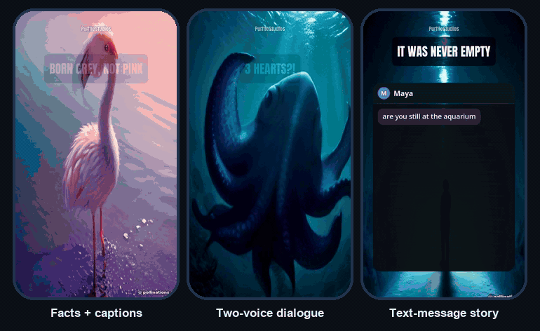

<div align="center">

# PurffleShorts — 免费 AI YouTube Shorts 短视频生成器、无露脸视频工具与 Opus Clip 替代品

[English](README.md) · **简体中文** · [Español](README.es.md) · [Português](README.pt-BR.md) · [हिन्दी](README.hi.md) · [日本語](README.ja.md)

**一款开源的 AI 视频生成器，适用于 YouTube Shorts、TikTok 和 Instagram Reels。给它一个主题、一个网页、一篇 Reddit 帖子或一期长播客，它就能生成完整的竖屏成片（脚本、配音、画面素材、字幕），然后上传到 YouTube、TikTok 和 Instagram，或定时发布。**

[](https://github.com/Chamanrajragu/purffle-shorts/actions/workflows/ci.yml)
[](https://colab.research.google.com/github/Chamanrajragu/purffle-shorts/blob/main/notebooks/PurffleShorts.ipynb)
[](LICENSE)
[](https://github.com/Chamanrajragu/purffle-shorts/stargazers)



<sub>真实输出，未经剪辑。使用免费的 Microsoft 神经网络语音和 AI 图片。GIF 动图没有声音。</sub>

**无需 API 密钥、无需注册即可试用**（需要安装 [uv](https://docs.astral.sh/uv/)）：

```bash
uvx --from git+https://github.com/Chamanrajragu/purffle-shorts purffle-shorts demo --style chat
```

……或者**[在 Google Colab 中打开](https://colab.research.google.com/github/Chamanrajragu/purffle-shorts/blob/main/notebooks/PurffleShorts.ipynb)**，无需安装任何东西，直接在浏览器里做视频。

**⭐ 如果 PurffleShorts 帮你节省了时间，点个 Star 能让更多创作者发现它。**

</div>

> 这是精简版。完整文档（所有设置、AI 模型、语音、字幕、发布、命令行、Studio、故障排查）请参阅 [英文版 README](README.md)。

## PurffleShorts 是什么？

PurffleShorts 是一款面向无人出镜频道的 YouTube Shorts 自动化工具。启动后它就会持续运转：挑选新主题，由你选择的 AI 模型撰写脚本，再经过第二轮 AI 审阅和精简，生成自然的 AI 配音，匹配相关的画面素材，加上与配音逐词同步的字幕，渲染出精良的成片，最后上传或定时发布。

它同时也是一个小型工作室：渲染前可以修改脚本的任意一行，可以制作双人对话、短信聊天故事和 Reddit 风格的故事，把一篇文章或一篇 Reddit 帖子做成一条 Short，把播客剪成多条 Shorts，还能用多种语言发布同一个视频。它在你自己的电脑上运行（macOS、Windows、Linux 或 Docker），生成的 9:16 MP4 文件同样适用于 TikTok 和 Instagram Reels。

## 功能特性

- **支持任意 AI 模型**：OpenAI GPT、Anthropic Claude、Google Gemini、DeepSeek、Mistral、xAI Grok、Groq、OpenRouter、Together AI、Ollama 和 LM Studio（本地运行，免费），或任何兼容 OpenAI 的 API。在 `LLM_FALLBACKS` 中列出备用服务商后，主服务商失败时会按顺序尝试。在支持的服务商（OpenAI、Gemini、OpenRouter、Ollama、LM Studio、Claude）上，回复会严格按照 JSON Schema 返回。
- **Script Doctor**：由第二轮 AI 从六个方面给每个脚本打分（开头钩子、好奇心、节奏、具体程度、结尾回报、准确性），列出薄弱之处并加以改写。改写后的版本会再打一次分，只有不低于原稿时才会采用，所以 0 到 100 分的留存分数始终属于你最终拿到的那份脚本。自动检查（开头太长、废话和口头禅、没有行动号召、没有具体数字）的结果也会交给审稿环节。
- **322 种免费神经网络语音，覆盖 75 种语言**，带词级时间戳，无需密钥。对话和聊天故事可使用两个不同的声音。
- **每句话都有画面**：来自 Pexels 或 Pixabay 的素材库视频（可免费申请密钥）、AI 图片，或你自己的媒体文件夹。每个候选素材都会按其自身描述与场景的匹配程度打分。
- **快节奏剪辑**：超过 4.5 秒的场景会拆成多个镜头，每个镜头用不同的素材，剪辑点落在词与词之间的自然停顿上（`MAX_SHOT_SECONDS`）。
- **背景视频（游戏画面）**：用 `--background parkour.mp4`（或 `BACKGROUND_VIDEO`），你的 Minecraft 跑酷、Subway Surfers 之类视频中连续的一段会在整个故事下方播放。可以全屏，也可以**分屏**（`--layout split`）：上方是场景素材，下方是背景视频。只使用你有权再次使用的视频。
- **逐词动画字幕**，提供六种样式，支持拉丁文、印度系文字、阿拉伯文、泰文和中日韩文字。对于不提供逐词时间戳的语音，每句话的结尾会对齐到音频里真实的停顿，字幕依然同步。
- **广播级音频**：先对人声做轻度处理（去除低频杂音、齿音消除、压缩），再做两遍响度标准化：先测量混音，再施加一个恒定增益，稳定达到 −14 LUFS，不会忽大忽小。
- **为留存而做的剪辑**：AI 标出的关键词和所有数字会用另一种颜色显示，每个场景有一个表情符号在字幕上方弹出。音效由代码生成（每次换场景有嗖的一声，每条消息有一声轻响，开头钩子下有一声低沉的冲击），混音时比人声低 11 dB。
- **封面图**：选开头几秒里最清晰、曝光最好的一帧，绝不会选到转场中间的画面。
- **9:16、16:9、1:1 或 4:5** 画幅输出，使用 ffmpeg 渲染，无需 GPU。
- **同时发布到 TikTok 和 Instagram Reels**（`PUBLISH_TO=youtube,tiktok,instagram`），每个平台使用单独调整的文案。
- **上传到 YouTube**，或把每个视频排进你的下一个空闲时段定时发布，并设置好 AI 内容声明。
- **一个视频，多种语言**：`--also-lang es,hi` 会生成复用同一套画面素材的翻译版本。
- **Studio 网页应用**，运行在你的电脑上：起草、编辑、渲染、浏览视频库。进度即时推送，显示百分比和剩余时间（根据你自己电脑的实际耗时估算），**Cancel** 按钮可以停止正在运行的任务。在服务器上运行时，可以用 `STUDIO_PASSWORD` 加上密码保护。
- **Google Colab、REST API 和 Docker**：可在浏览器中使用的 [Colab 笔记本](https://colab.research.google.com/github/Chamanrajragu/purffle-shorts/blob/main/notebooks/PurffleShorts.ipynb)、附带 n8n 示例的 REST API 文档（[docs/api.md](docs/api.md)），以及用于服务器的 `docker compose`。
- 终端里有实时进度条；还有语音缓存：重新渲染修改过的脚本时，只会为改动过的句子重新配音。
- **MCP 服务器**：让 Claude Desktop、Claude Code 或 Cursor 帮你制作、剪辑或上传视频。
- **从你的频道学习**（可选，`LEARN_FROM_STATS`）：有 8 个或更多带统计数据的视频后，每个新视频的格式会根据真实播放量用汤普森采样来选择；`stats` 会告诉你留存分数是否真的能预测播放量（斯皮尔曼相关系数），以及哪些发布时段表现最好。
- **内置 SEO**：写稿之前先查看人们在 YouTube 上实际搜索的、与该主题相关的词句，并把它们原样用在标题、简介和标签里。也可以直接从这些搜索中选题（`TOPIC_SOURCES=search`），为其他语言的观众翻译标题和简介（`LOCALIZE_METADATA=en,es`），还可以上传精确的字幕（`UPLOAD_CAPTIONS`）。

## 视频类型

| 类型 | 生成效果 |
|---|---|
| `facts` · `story` · `listicle` · `myth` · `quiz` · `explainer` · `motivational` · `news` | 单人旁白，每个场景都有画面素材，逐词高亮字幕 |
| `dialogue` | 两个人对话，各自使用不同的声音；字幕会标出说话人的名字和对应颜色 |
| `chat` | 短信聊天故事：随着朗读，消息在动画手机屏幕上逐条弹出，并带有“正在输入”提示 |
| `reddit` | 以 Reddit 帖子形式讲述的第一人称故事：朗读标题时显示帖子卡片，随后配合字幕讲述正文 |

```bash
purffle-shorts make --style chat --topic "保姆收到陌生号码发来的短信"
purffle-shorts make --style reddit --topic "总来借我梯子的邻居"
```

## 快速开始

需要 Python 3.10 或更高版本。如果已安装 ffmpeg 则直接使用，否则使用自带的版本。

```bash
git clone https://github.com/Chamanrajragu/purffle-shorts.git
cd purffle-shorts
python -m venv venv && source venv/bin/activate      # Windows: venv\Scripts\activate
pip install -e .
python -m purffle_shorts demo                        # 示例视频，无需任何密钥
python -m purffle_shorts studio                      # Web 应用
```

然后把 `.env.example` 复制为 `.env`，填入一个 AI 密钥（或运行 Ollama）以及一个免费的 Pexels 或 Pixabay 密钥，再运行 `python -m purffle_shorts doctor` 检查配置。`python -m purffle_shorts make --topic "why octopuses have three hearts" --no-upload` 生成一个视频；`python -m purffle_shorts auth` 连接你的 YouTube 频道；`python -m purffle_shorts run` 启动全自动模式。

## 把长视频剪成 Shorts

```bash
pip install faster-whisper yt-dlp
purffle-shorts clip podcast.mp4 --count 3 --no-upload
purffle-shorts clip interview.mp4 --crop face        # 让画面跟随说话人的脸（pip install opencv-python-headless）
purffle-shorts clip episode.mp4 --prompt "最搞笑的片段"   # 只挑符合你要求的片段
```

视频会先被转录成文字，AI 挑出能单独成立的片段，每个片段都会变成一条带字幕的竖屏短片。功能类似 Opus Clip，但在你自己的电脑上运行，也不按分钟收费。转录使用 `WHISPER_MODEL`（`auto` 在 NVIDIA GPU 上选 `large-v3-turbo`，在 CPU 上选 `small`），并开启语音活动检测，避免把音乐和静音误转成凭空出现的字词。加上 `--crop face` 后，每秒检测两次说话人的脸并让它保持在画面中，只有镜头切换时才改变构图。请只剪辑你拥有版权或已获授权二次使用的视频。

每个片段都会像剪辑师那样处理：**跳剪**缩短过长的停顿，删掉 "um"、"uh" 这类口头停顿（画面和声音在同一帧上剪，所以口型始终同步）；**推近变焦**在句与句之间切换构图。每个片段都附带**爆款评分**和理由。用 `--no-jump-cuts` 和 `--no-zoom` 可以关闭。

## 在 Claude 和其他 AI 应用中使用（MCP）

```json
{
  "mcpServers": {
    "purffle-shorts": {
      "command": "purffle-shorts",
      "args": ["mcp"],
      "env": { "PURFFLE_HOME": "/path/to/your/purffle/folder" }
    }
  }
}
```

然后直接提需求，例如：“用西班牙语做一个 30 秒的短信故事，讲一个闹鬼的智能音箱。”除非你要求，否则不会上传任何内容。

## 常见问题

**免费吗？** 是的。项目采用 MIT 许可证，在你的电脑上运行。语音、Ollama 模型以及 Pexels 和 Pixabay 的 API 都是免费的；只有你选用的付费 API（比如 OpenAI 或 ElevenLabs）才需要付费。

**没有 API 密钥能试用吗？** 可以：`demo` 命令无需任何密钥即可渲染一个示例视频。

**能发布到 TikTok 或 Instagram 吗？** 可以：`PUBLISH_TO=youtube,tiktok,instagram`。TikTok 通过 [Upload-Post](https://www.upload-post.com) 发布（`UPLOAD_POST_API_KEY`、`UPLOAD_POST_USER`；TikTok 需要付费套餐），因为 TikTok 自己的 API 只允许通过审核的应用发布公开视频。Instagram 可以用免费的官方 API（`INSTAGRAM_USER_ID`、`INSTAGRAM_ACCESS_TOKEN`）或 Upload-Post。每个平台都有自己的文案，并在同一时间发布；`upload --id N` 只会重发失败的部分。这项集成按照各服务公开的 API 实现，但还没有在真实账号上测试过。

**需要 GPU 吗？** 不需要。渲染由 ffmpeg 在 CPU 上完成。如果有 NVIDIA GPU，`clip` 的转录会用上它。

**允许自动上传吗？** 它使用官方的 YouTube Data API，通过你自己的 Google 账号登录，并设置 YouTube 的合成内容声明。请审核你的视频，并遵守 YouTube 的相关政策。

## 许可证

MIT。由 [Chaman Raj](https://github.com/Chamanrajragu) 开发 · [purffle.com](https://purffle.com/purffle-shorts/)。与 YouTube、OpenAI、Anthropic、Google、Microsoft、Pexels、Pixabay、Pollinations 或 Reddit 均无关联。
